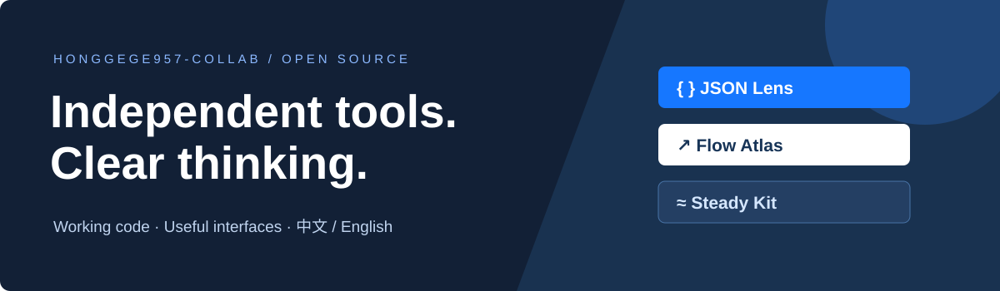

### Tools for debugging AI coding sessions and reviewing Go changes

AI 编码会话复盘 · Go 改动影响分析

   

## Working on / 重点项目

| Project | Who it helps | Try it |
| --- | --- | --- |
| **[Agent Rewind](https://github.com/chenpingan-dev/agent-rewind)** · Python | Codex users: replay an exported session, locate repeated/failed tool calls and compare two runs / 从日志定位 AI 编码的重复执行与失败调用 | [Replay demo](https://chenpingan-dev.github.io/agent-rewind/) · [Install](https://github.com/chenpingan-dev/agent-rewind#try-it-in-one-minute) |
| **[Patch Orbit](https://github.com/chenpingan-dev/patch-orbit)** · Go | Go reviewers: map committed changes to dependent packages, with import files and line numbers / 沿 import 链查看改动涉及哪些 Go 包 | [Impact map](https://chenpingan-dev.github.io/patch-orbit/) · [Download](https://github.com/chenpingan-dev/patch-orbit/releases) |

Both tools work locally, without a model API key or backend service. Reports are portable HTML files. Live demos use clearly labeled synthetic data and support 中文 / English

两款工具都能在本地生成报告，定位依据可以在界面中查看

More independent tools / 其他独立项目

| Project | Purpose | Entry |
| --- | --- | --- |
| [JSON Lens](https://github.com/chenpingan-dev/json-lens) | Explore JSON trees, pointers and structural differences | [Demo](https://chenpingan-dev.github.io/json-lens/) |
| [Flow Atlas](https://github.com/chenpingan-dev/flow-atlas) | Explore dependency paths and worker schedules | [Demo](https://chenpingan-dev.github.io/flow-atlas/) |
| [Steady Kit](https://github.com/chenpingan-dev/steady-kit) | Async retry, circuit breaking and bounded concurrency | [Demo](https://chenpingan-dev.github.io/steady-kit/) |
| [Task Weaver](https://github.com/chenpingan-dev/task-weaver) · Java | Dependency-aware task execution and failure propagation | [Example](https://github.com/chenpingan-dev/task-weaver#run-the-example) |
| [Data Sieve](https://github.com/chenpingan-dev/data-sieve) · Python | CSV validation with explicit rules and precise findings | [CLI](https://github.com/chenpingan-dev/data-sieve#try-it) |
| [Pulse Probe](https://github.com/chenpingan-dev/pulse-probe) · Go | HTTP request-stage timing and connection reuse | [CLI](https://github.com/chenpingan-dev/pulse-probe#run-locally) |

Independent personal projects · MIT · Synthetic examples · AI-assisted development
