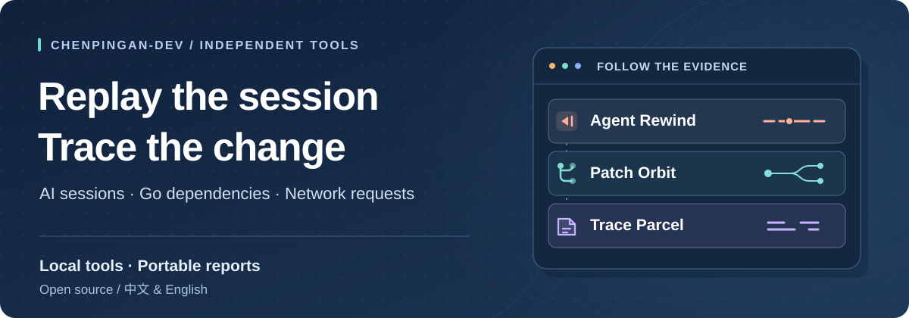

<picture>
  <source media="(max-width: 600px)" srcset="assets/profile-cover-mobile.svg" />
  
</picture>

### Understand the run · Review the change · Explain the bug

I’m Chen Pingan — I build open-source tools that make debugging and code review easier

[English](README.md) · [简体中文](README.zh-CN.md)

 

<table>
<tr>
<td width="70%" valign="top">
  <h3><a href="https://github.com/chenpingan-dev/agent-rewind">Agent Rewind</a></h3>
  
<strong>A replay button for Codex</strong>

  
Replay tool calls, inspect failures and repeated commands, then compare two runs

  
<code>Python</code> &nbsp; · &nbsp; <a href="https://chenpingan-dev.github.io/agent-rewind/"><strong>Open replay →</strong></a>

</td>
<td width="30%" align="center">
  <a href="https://github.com/chenpingan-dev/agent-rewind"><picture><source media="(max-width: 600px)" srcset="assets/agent-rewind-mark.svg" /></picture></a>
</td>
</tr>
<tr>
<td width="70%" valign="top">
  <h3><a href="https://github.com/chenpingan-dev/patch-orbit">Patch Orbit</a></h3>
  
<strong>See what a Go change touches</strong>

  
Follow reverse imports to the packages worth reviewing, with source files and line numbers

  
<code>Go</code> &nbsp; · &nbsp; <a href="https://chenpingan-dev.github.io/patch-orbit/"><strong>Explore dependencies →</strong></a>

</td>
<td width="30%" align="center">
  <a href="https://github.com/chenpingan-dev/patch-orbit"><picture><source media="(max-width: 600px)" srcset="assets/patch-orbit-mark.svg" /></picture></a>
</td>
</tr>
<tr>
<td width="70%" valign="top">
  <h3><a href="https://github.com/chenpingan-dev/trace-parcel">Trace Parcel</a></h3>
  
<strong>Turn a HAR into a useful bug report</strong>

  
Select relevant requests, redact sensitive fields and export HTML, HAR or an issue summary

  
<code>TypeScript</code> &nbsp; · &nbsp; <a href="https://chenpingan-dev.github.io/trace-parcel/"><strong>Prepare a report →</strong></a>

</td>
<td width="30%" align="center">
  <a href="https://github.com/chenpingan-dev/trace-parcel"><picture><source media="(max-width: 600px)" srcset="assets/trace-parcel-mark.svg" /></picture></a>
</td>
</tr>
</table>

All three process data locally, support English and Chinese, and export standalone HTML reports

## Data & workflow tools

- **[JSON Lens](https://github.com/chenpingan-dev/json-lens)** · JavaScript Explore JSON trees, locate values and compare structures · [Open workbench →](https://chenpingan-dev.github.io/json-lens/)
- **[Flow Atlas](https://github.com/chenpingan-dev/flow-atlas)** · JavaScript Plan dependencies, critical paths and execution schedules · [Open planner →](https://chenpingan-dev.github.io/flow-atlas/)
- **[Task Weaver](https://github.com/chenpingan-dev/task-weaver)** · Java Run dependent tasks and handle failure propagation · [Read guide →](https://github.com/chenpingan-dev/task-weaver#run-a-workflow)

---

Personal projects · MIT licensed · AI-assisted development
