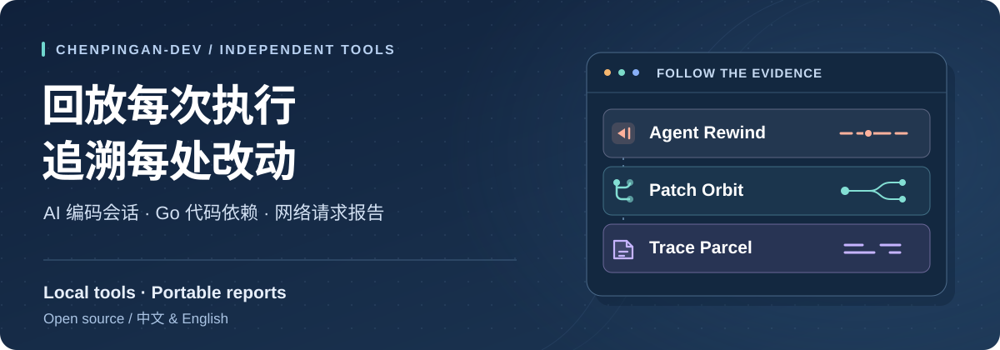
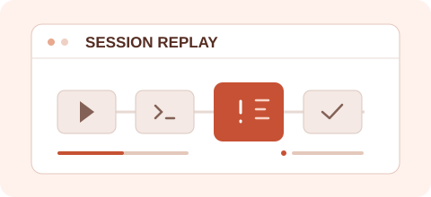
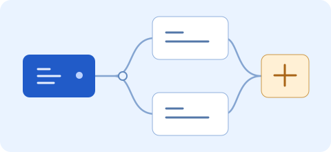

<picture>
  <source media="(max-width: 600px)" srcset="assets/profile-cover-mobile.zh-CN.svg" />
  
</picture>

### 看懂执行过程，找到改动影响，把问题交代清楚

我是陈平安，做一些让排查和评审更顺手的开源工具

[English](README.md) · [简体中文](README.zh-CN.md)

 

<table>
<tr>
<td width="70%" valign="top">
  <h3><a href="https://github.com/chenpingan-dev/agent-rewind">Agent Rewind</a></h3>
  
<strong>给 Codex 会话加一个回放键</strong>

  
回放工具调用，定位失败与重复执行，直接对照输入、输出和两次运行记录

  
<code>Python</code> &nbsp; · &nbsp; <a href="https://chenpingan-dev.github.io/agent-rewind/"><strong>打开会话回放 →</strong></a>

</td>
<td width="30%" align="center">
  <a href="https://github.com/chenpingan-dev/agent-rewind"><picture><source media="(max-width: 600px)" srcset="assets/agent-rewind-mark.svg" /></picture></a>
</td>
</tr>
<tr>
<td width="70%" valign="top">
  <h3><a href="https://github.com/chenpingan-dev/patch-orbit">Patch Orbit</a></h3>
  
<strong>改了一个包，还需要检查哪里</strong>

  
沿反向依赖找到需要评审的 Go 包，查看每条关联对应的 import 文件与行号

  
<code>Go</code> &nbsp; · &nbsp; <a href="https://chenpingan-dev.github.io/patch-orbit/"><strong>查看依赖关系 →</strong></a>

</td>
<td width="30%" align="center">
  <a href="https://github.com/chenpingan-dev/patch-orbit"><picture><source media="(max-width: 600px)" srcset="assets/patch-orbit-mark.svg" /></picture></a>
</td>
</tr>
<tr>
<td width="70%" valign="top">
  <h3><a href="https://github.com/chenpingan-dev/trace-parcel">Trace Parcel</a></h3>
  
<strong>把一堆抓包记录，整理成问题报告</strong>

  
筛出相关请求，处理敏感字段，导出可供检查的 HTML、HAR 和问题摘要

  
<code>TypeScript</code> &nbsp; · &nbsp; <a href="https://chenpingan-dev.github.io/trace-parcel/"><strong>整理问题报告 →</strong></a>

</td>
<td width="30%" align="center">
  <a href="https://github.com/chenpingan-dev/trace-parcel"><picture><source media="(max-width: 600px)" srcset="assets/trace-parcel-mark.svg" /></picture></a>
</td>
</tr>
</table>

这三款工具都在本地处理数据，支持中文与英文，并可导出独立 HTML 报告

## 数据与任务工具

- **[JSON Lens](https://github.com/chenpingan-dev/json-lens)** · JavaScript 浏览 JSON 结构、定位字段、比较数据差异 · [打开工作台 →](https://chenpingan-dev.github.io/json-lens/)
- **[Flow Atlas](https://github.com/chenpingan-dev/flow-atlas)** · JavaScript 规划任务依赖、分析关键路径、查看执行排期 · [打开规划器 →](https://chenpingan-dev.github.io/flow-atlas/)
- **[Task Weaver](https://github.com/chenpingan-dev/task-weaver)** · Java 按依赖执行任务并处理失败传播 · [查看使用指南 →](https://github.com/chenpingan-dev/task-weaver/blob/main/README.zh-CN.md#运行任务编排)

---

个人独立项目 · MIT 开源 · AI 辅助开发
